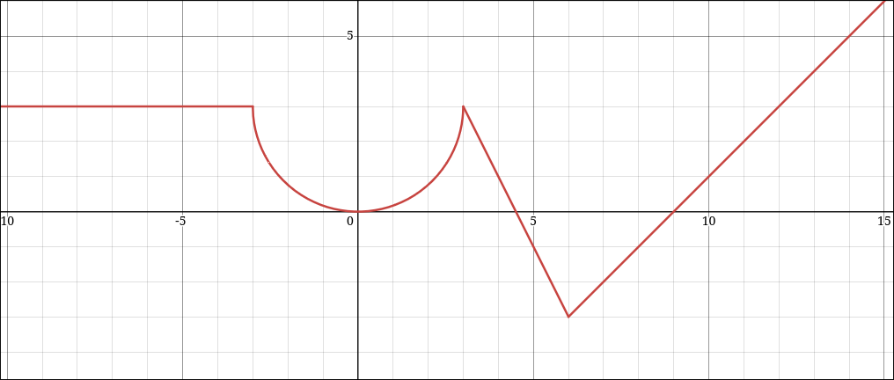
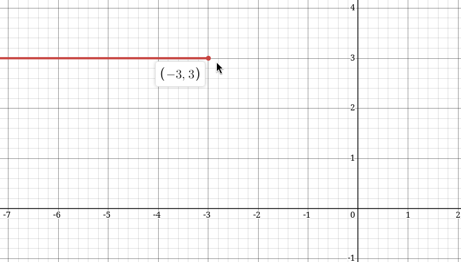
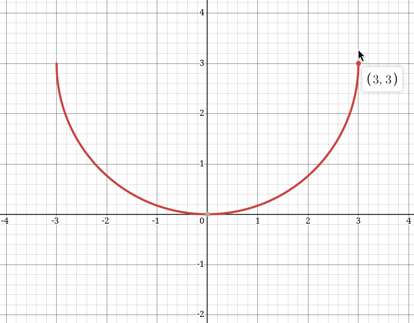
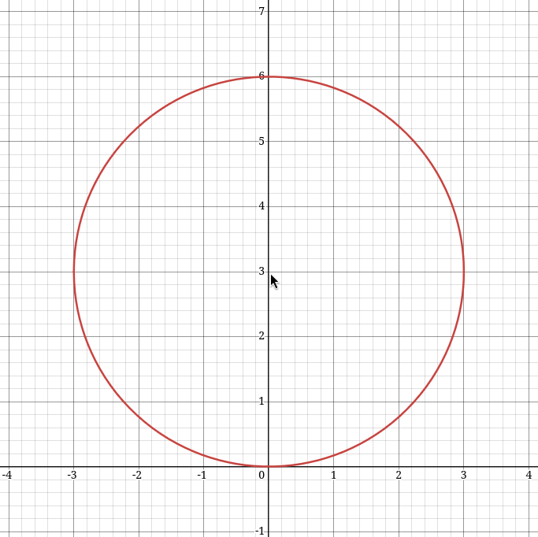
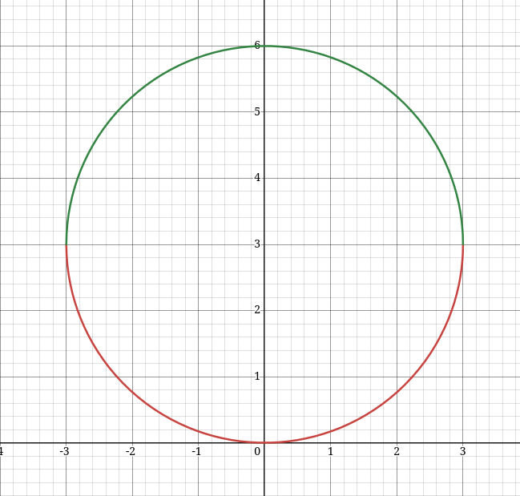

Дана кусочно заданная функция с графиком представленном на рисунке. Задание по этому графику написать программу, которая будет для значения X вычислять значение Y
График следующий:

Он сделан по памяти, поэтому от исходного задания может немного отличаться, но суть задания от этого не меняется, так же поправка здесь не всегда видны важные точки, но постараюсь все подробно описывать

### Этап 0. Что вообще от нас хотят?
Нам дан график функции, более того, это график кусочно-заданной функции, но что это такое?
Введу немного определений, постараюсь говорить простым языком. В данном частном случае определение функции можно сформулировать следующим образом. Функцией $y = f(x)$ называется правило в соответствии с которым некоторому значению x в соответствие однозначно ставится значение y. Гововоря проще, функция принимает в себя некоторое число x и на выходе выдает какое-то число y
Дальше, я называл данную функцию кусочно-заданной. Это означает, что функция описывается разными функциями определенными на каких-либо отрезках. Проще говоря видно по графику, что изображенная тут функция какая-то сложная, одной формулой ее не описать, просто потому, что она описывается четыремя разными формулами. Далее мы будет поэтапно для каждого участка искать функцию и готовить финальный вид

### Этап 1. Вычисление функции
Так как функция задана кусочно, то значит и кусочки нужно рассматривать отдельно

##### Кусочек 1

Это по сути просто график прямой y = 3. Если говорить подробнее, то какое бы не было значение x на входе (на отрезке x < -3) значение всегда одно и постоянно. Иначе говоря функция $f(x) = 3$, так бывает, функция не обязана зависеть от самого x
В заключении можно написать следующее, первый компонент нашей кусочной функции это  $$y = 3, x < -3$$
##### Кусочек 2

Самый сложный и вместе с тем самый интересный кусочек. Тут дана дуга окружности и сам по себе этот пример достаточно интересный, потребует некоторой математической справки чтобы понимать процесс

В методических материалах приводится определение функции окружности, в общем виде оно выглядит так $(x-a)^2 + (y-b)^2 = R^2$. Что такое a, b и R? Это параметры окружности, они задают положение центра окружности и соответственно радиус
Рассмотрим картинку. Не сложно по ней догадаться, что центр данной окружности находится в точке $(0, 3)$, то есть координата центра по x = 0, а координата y = 3. Радиус тоже несложно увидеть, что он равен 3. Следовательно функция в нашем случае преобретает следующий вид: $x^2 + (y - 3)^2 = 3^2$. Но такой вид для нашей задачи не подходит по двум причинам:
1) Если просто забить эту формулу в графический калькулятор, то мы получим следующее:
   
   То есть мы вспоминаем, что формула вообще-то задает полную окружность, а нам нужна только нижняя дуга
2) Нам нужен явный вид $y = f(x)$, здесь такого вида нет, значит нам эту формулу нужно к этому виду как-то привести

Решение на самом деле достаточно простое и элегантное, просто выразим y простыми преобразованиями уравнений, далее будет пошаговый процесс
$$
x^2+(y-3)^2 = 9 \\
(y-3)^2 = 9 - x^2 \\
y - 3 = \pm \sqrt{9 - x^2}\\
y = \pm \sqrt{9 - x^2} + 3$$
Возможно не лишним будет напомнить причину появления знака $\pm$ перед корнем, ведь так как мы избавлялись от квадрата слева мы обязаны были поставить этот знак перед корнем. Что остается в этой формуле не так? Ну как минимут то, что мы решили только вторую проблему из двух озвученных, да и более того, само по себе эта запись на самом деле это две разные формулы записанные как одна, просто одна со знаком + перед корнем, другая с -. Что делаем дальше? Нам нужно выбрат, для наглядности я изобразил обе эти формулы в графическом калькуляторе, но изобразил их разными цветами, это выглядит следующим образом:

Нам нужна нижняя половина и ей соответствует формула $y = -\sqrt{9 - x^2} + 3$, полная запись тогда будет выглядеть вот так 
$$y = - \sqrt{9 - x^2} + 3, -3 \pm x < 3$$